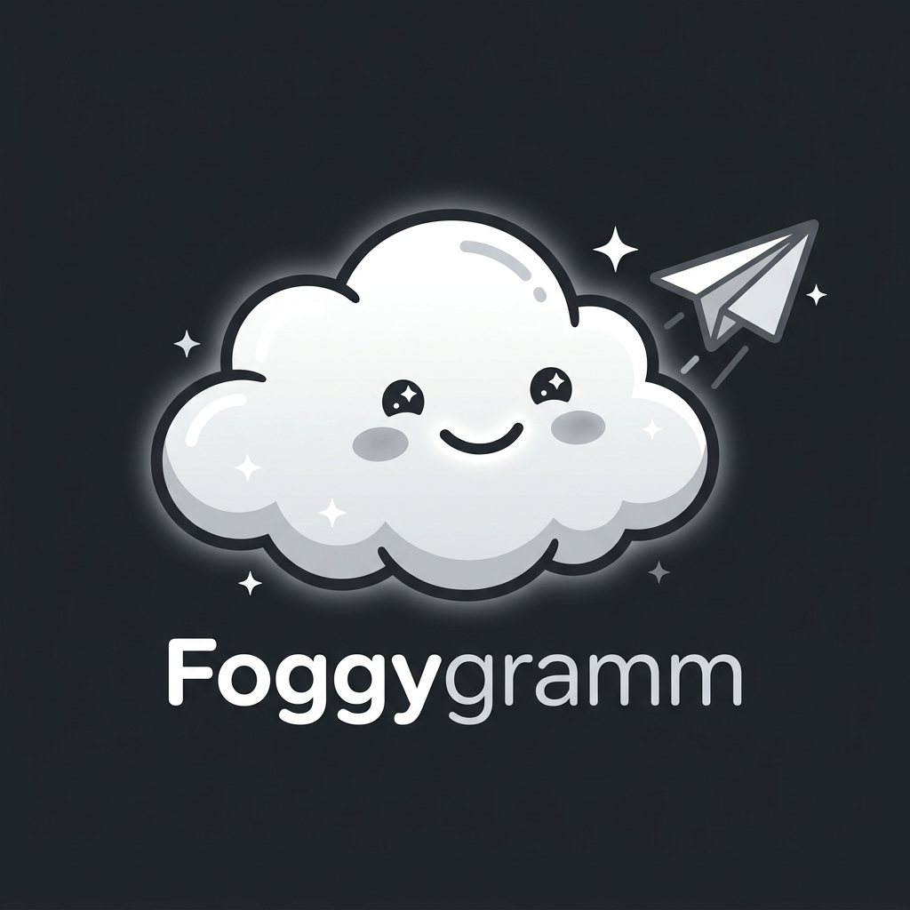

# 🌫️ Foggygram

> An unofficial Telegram desktop client crafted with macOS glassmorphism, zero-accent monochrome aesthetics, an encrypted multi-account session vault, and an autonomous AI agent mascot.



---

## ✨ Features

- **🔐 Encrypted Session Vault**:
  - Securely stores unlimited Telegram account sessions using **AES-256-GCM** with **PBKDF2** key derivation.
  - Unlock all accounts seamlessly with your Master PIN or Password — **no repeated SMS or OTPs needed**.
  - One-click encrypted backup payload (`.foggyvault`) prevents account loss if SIM cards expire or devices change.

- **🌫️ 3D Cloud Mascot**:
  - Volumetric animated puffs with radial lighting and perspective 3D parallax.
  - Interactive eye tracking, gentle floating bobbing, and glint reflections.
  - **Password Peeker**: Animated hands slide up to cover the cloud's eyes while you type your vault PIN or password.

- **👻 Ghost Protocol (Stealth Mode)**:
  - Suppress message read receipts (`messages.readHistory` intercepted and dropped).
  - Hide online status and typing activity.
  - Invisible story viewing with per-chat overrides.

- **🗑️ Deleted Message Recovery**:
  - Intercepts Telegram message deletion and edit events.
  - Preserves deleted content locally in cache with original timestamps, sender info, and `[Recovered by Foggygram]` labels.

- **✨ Agentic AI Cloud Assistant**:
  - **Summarize**: Condense large message threads into action items.
  - **Smart Reply**: Draft replies in multiple tones (Formal, Friendly, Concise).
  - **Autonomous Telegram Settings**: Natural language command execution (e.g. *"enable ghost mode"*, *"backup vault"*).

- **🎨 Pure Monochrome Glassmorphism**:
  - Zero non-monochrome accent colors: strict palette of pure black (`#000000`), frosted white (`#F5F5F7`), and subtle glass borders (`rgba(255,255,255,0.12)`).
  - 28px Gaussian blur, 160° linear gradient panels, and hover illumination glow.
  - macOS 3-column desktop layout (Account Rail | Chat List | Conversation Pane | Profile/Media Pane).

---

## 🛠️ Tech Stack

- **Framework**: [Flutter 3.x](https://flutter.dev) (Windows Desktop)
- **Language**: Dart 3.8+
- **State Management**: [Riverpod](https://riverpod.dev)
- **Cryptography**: `pointycastle` (AES-256-GCM, PBKDF2)
- **Local Cache**: Drift (SQLite)
- **Routing**: `go_router` with custom fade transitions

---

## 🚀 Getting Started

### Prerequisites

- Flutter SDK (>= 3.10.0)
- Git

### Installation

```bash
# Clone the repository
git clone https://github.com/madara896/foggygram.git
cd foggygram

# Install dependencies
flutter pub get

# Run tests
flutter test

# Run Foggygram
flutter run -d windows
```

---

## 📄 License

This project is open-source and intended for educational and personal privacy purposes. Telegram is a trademark of Telegram FZ-LLC.
